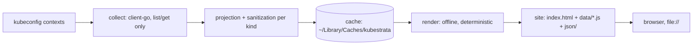

# kubestrata design

[Português](design.pt-BR.md)

Status: pre-release design for v0.1.0 (F1). Decisions here are current until code says otherwise.

## Goal

Read-only inventory of the clusters in your kubeconfig, cached locally, rendered as an offline
HTML view where **recent resources sit in the center and old ones at the edge**, plus a
**side-by-side comparison of two clusters**. The audience is the engineer planning a cluster
migration: what exists, who owns it, how it got there, what has state, what is exposed, and what
is still moving.

## Flow



`render` and `compare` never talk to a cluster. Refreshing the cache is always explicit
(`collect --force`, `--max-age`, or `r` in the TUI).

## Time axis

| Field | Meaning | Use |
|---|---|---|
| `metadata.creationTimestamp` | object creation; reset when CI deletes and re-applies | default axis |
| newest `managedFields[].time`, **ignoring `subresource: status`** | last spec/metadata change by any manager | `changed` axis: what is still moving |
| Pod age | last rollout or reschedule, not workload age | not an axis: pods are aggregated into their owner |

Status updates are ignored on purpose: controllers write status constantly and everything would
look recent.

## Layout: deterministic polar, not force-directed

Angle = namespace sector (grouped by team, sized by object count), sub-sector by category.
Radius = age on the selected ring scale. Edges (Ingress → Service → Workload → PVC / Secret /
ConfigMap / ServiceAccount) are drawn on hover or selection only.

| Criterion | Force-directed | Polar (chosen) |
|---|---|---|
| Scale | O(n²) repulsion, fine for hundreds | O(n); collisions resolved on a spatial grid |
| Compare | the same object lands in different places | sectors computed over A∪B: same namespace, same angle on both sides |
| Determinism | depends on the simulation | same input, same picture |

Ring scales switch in the browser without regenerating: `5d`, `10d`, `30d` (12 linear rings plus
a compressed outer band), `log` (7d / 30d / 90d / 1y+, saturating at 3 years) and custom
`--rings 5,15,30,90,180,365`.

## Collection

- Kubeconfig: client-go default loading rules (`KUBECONFIG` with several files, `--kubeconfig`);
  exec plugins work unchanged. An auth failure in one context is a structured error and does not
  stop the others.
- Cluster identity: `sha256(server URL + kube-system namespace UID)[:12]`. Context names are not
  identities.
- Discovery (`ServerPreferredResources`): served kinds, CRDs and OpenShift types without a
  hard-coded list. Distro inferred from API groups, server URL and node labels.
- API server load: `list`/`get` only, `limit=500` pagination, explicit QPS/burst, at most 4
  contexts and 8 kinds in flight per context.
- RBAC: a `403` on a kind goes to `errors[]` and collection continues. Listing Secrets grants read
  access to their values even though kubestrata only asks for metadata; the docs ship a suggested
  `inventory-reader` ClusterRole.

## Sanitization (security boundary)

The snapshot stores a curated projection, never raw objects.

| Risk | Handling |
|---|---|
| Secret values | Secrets are read through the server-side Table (`as=Table;g=meta.k8s.io;v=v1`, `includeObject=Metadata`): type and key count, no `data` |
| `kubectl.kubernetes.io/last-applied-configuration` | dropped from every object: for a Secret applied with `kubectl apply` it holds the base64 `data` |
| literal `env[].value`, `args`, `command` | names only, values dropped |
| ConfigMap | key names + content hash (for drift), no values |
| `managedFields` | only `manager`, `operation`, `time`, `subresource` |
| OpenShift Route `spec.tls.key` / `certificate` | dropped: only the termination type is kept |
| Cloud identity annotations (IRSA role ARN, workload identity ids) | only the identity type (`aws-irsa`, ...), never the ARN or id |
| Annotations in general | not stored; facts are derived from the few that matter |
| Cache and site | `0700` / `0600` under the user cache dir, never in git |
| XSS in the local page | names and labels are untrusted: `json.Marshal` (escapes `<>&`) writes `data/*.js`, the page renders with `textContent` |

A test seeds known values into Secrets and env vars and fails if any of them appears in any byte
of the cache or the site.

## Default kinds and categories

| Category | Kinds | Notes |
|---|---|---|
| workload | Deployment, StatefulSet, DaemonSet, CronJob, Job without owner, DeploymentConfig, orphan Pod and ReplicaSet | pods aggregated into their owner; an orphan pod is a migration warning |
| network | Service, Ingress, Route, Gateway, HTTPRoute, NetworkPolicy | hosts and TLS in the panel |
| config | ConfigMap (minus `kube-root-ca.crt`, `openshift-service-ca.crt`), Secret, ServiceAccount | `helm.sh/release.v1` Secrets grouped as Helm state |
| storage | PVC, PV, StorageClass, VolumeSnapshot | cluster-scoped kinds get their own sector |
| policy | HPA, PDB, ResourceQuota, LimitRange, Role, RoleBinding | PDBs affect drain and cutover |
| CRDs | custom resources in application namespaces | grouped by API group |
| system | namespaces matching `^(kube-|openshift|amazon-|aws-|gke-|azure-)` | hidden by default (`--exclude-ns`) |

## Snapshot contract (`schema_version: 1`)

```json
{
  "schema_version": 1,
  "tool": {"name": "kubestrata", "version": "0.1.0"},
  "collected_at": "2026-11-17T12:12:00Z",
  "cluster": {"id": "3f9a1c0b7e21", "context": "source", "server_host": "api.example:6443",
              "distro": "openshift", "distro_signals": ["group route.openshift.io"], "version": "v1.27.x",
              "nodes": {"count": 12, "arch": {"amd64": 12}, "zones": ["a", "b"]}},
  "namespaces": [{"name": "payments", "team": "team-payments", "created": "2024-06-01T00:00:00Z"}],
  "resources": [{
    "id": "apps/Deployment/payments/api", "cat": "workload", "ns": "payments", "name": "api",
    "created": "2025-04-24T10:00:00Z", "changed": "2026-10-02T18:30:00Z",
    "manager": "helm", "app": "payments-api", "team": "team-payments",
    "facts": {"replicas": 3, "ready": 3, "pods": 3, "restarts": 1, "images": ["registry/pay/api:2.14"]},
    "fp": "sha256:..."
  }],
  "edges": [{"from": "networking.k8s.io/Ingress/payments/api", "to": "core/Service/payments/api", "rel": "routes"}],
  "errors": [{"kind": "core/Secret", "ns": "data", "reason": "Forbidden"}]
}
```

| `rel` | From → to |
|---|---|
| `routes` | Ingress, Route, HTTPRoute → Service |
| `selects` | Service, PodDisruptionBudget → workload (selector ⊆ pod template labels) |
| `mounts` | workload → PVC, Secret, ConfigMap (volumes); VolumeSnapshot → PVC |
| `env-from` | workload → Secret, ConfigMap (`envFrom`, `valueFrom`) |
| `uses-sa` | workload → ServiceAccount |
| `pull-secret` | workload → Secret (`imagePullSecrets`) |
| `owns` | controller owner → shown object (e.g. a custom resource → its Deployment) |
| `binds` | PVC → PersistentVolume, StorageClass |
| `tls` | Ingress, Gateway → Secret |
| `scales` | HPA → target |
| `grants` | RoleBinding → Role, ServiceAccount |
| `attaches` | HTTPRoute → Gateway |

Edges are computed in Go, not in the browser. A reference to an object that does not exist goes to
`facts.missing_refs`; a Service whose selector matches no workload gets `facts.selects_none`. A
consumer that receives a higher `schema_version` than it supports refuses the document.

Pods, ReplicaSets, ReplicationControllers and Jobs are folded into the nearest shown owner
(`pods`, `ready`, `restarts`, `pod_newest`, `pod_oldest`, `archs`, `last_rollout`, `jobs`,
`last_run`). Without an owner they are shown with `facts.orphan`.

## Comparison

Identity key: `group/kind/namespace/name`. States: only in source (pending), only in target (new),
equal, drift. Drift uses a per-kind fingerprint of migration-relevant fields; a full-spec hash
would flag defaulting differences between Kubernetes versions.

| Kind | Fingerprint |
|---|---|
| Deployment, StatefulSet, DaemonSet, DeploymentConfig | images (repo:tag@digest), replicas, requests/limits, volume and envFrom names |
| Service | type, ports |
| Ingress, Route, HTTPRoute | hosts, paths, TLS secret names, class |
| PVC | storageClass, size, accessModes |
| ConfigMap | key names + content hash |
| Secret | type + key count |

Synchronized zoom and pan; hovering a node highlights its pair. A per-namespace table shows
source total, target total, pending, drift, only-in-target and coverage.

## CLI and TUI

Fang v2 over Cobra for commands; Bubble Tea v2, Bubbles v2, Lip Gloss v2 and Huh for the TUI.
`--format text|json` on every command.

| Command | Does |
|---|---|
| `kubestrata` | TUI: contexts, cache age, status; `r` refresh, `g` generate, `c` compare, `o` open |
| `kubestrata contexts` | kubeconfig contexts (no cluster access) |
| `kubestrata collect [-c ctx]... [--all] [--kinds ...] [--max-age 6h] [--force]` | writes the cache; reuses a snapshot newer than `--max-age` |
| `kubestrata render [-c ctx] [--scale 5d\|10d\|30d\|log] [--axis created\|changed] [-o dir] [--open]` | site from the cache |
| `kubestrata compare -c source -c target [--open]` | side-by-side site from the cache |
| `kubestrata cache ls\|prune [--keep 5]` | snapshot housekeeping |

Site output (default under the user cache dir): `index.html` (inline CSS and JS, no CDN),
`data/<cluster_id>.js` (`window.SNAP["<id>"] = {...}`; a script tag, because Chrome blocks
`fetch()` of local JSON on `file://`), `json/<cluster_id>.json` for machines.

## Phases

| Phase | Scope | Done when |
|---|---|---|
| F1 (v0.1.0) | contexts, collect + cache, render, compare, basic TUI, JSON output | e2e green on two local clusters; golden HTML identical across runs; no-leak test green; page loads with no JS error in headless Chrome; 20k nodes pan and zoom measured |
| F2 | migration units, classification (manager, state, exposure, cloud coupling, end of life), `plan --format json\|csv\|md`, per-team brief, `--map-ns` | plan for the fixture matches a fixed ground truth |
| F3 | temporal diff between snapshots, multi-arch image check, `kubectl strata` via Krew | decided once F2 is in real use |
