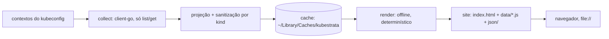

# Design do kubestrata

[English](design.md)

Status: design pré-release da v0.1.0 (F1). As decisões aqui valem até o código dizer o contrário.
A versão em inglês (`design.md`) é a oficial; esta é a tradução.

## Objetivo

Inventário somente leitura dos clusters do kubeconfig, guardado num cache local e exibido numa
visão HTML offline em que **os recursos recentes ficam no centro e os antigos na borda**, mais uma
**comparação lado a lado de dois clusters**. O público é quem planeja uma migração de cluster: o
que existe, quem é o dono, como chegou lá, o que tem estado, o que está exposto e o que ainda está
mudando.

## Fluxo



`render` e `compare` nunca falam com cluster. Atualizar o cache é sempre explícito
(`collect --force`, `--max-age` ou `r` na TUI).

## Eixo do tempo

| Campo | Significado | Uso |
|---|---|---|
| `metadata.creationTimestamp` | criação do objeto; zera quando o CI apaga e reaplica | eixo padrão |
| maior `managedFields[].time`, **ignorando `subresource: status`** | última mudança de spec/metadata por qualquer manager | eixo `alterado`: o que ainda está em movimento |
| idade do Pod | último rollout ou reagendamento, não a idade do workload | não vira eixo: pods são agregados no dono |

Os updates de status são ignorados de propósito: controllers gravam status o tempo todo e tudo
pareceria recente.

## Layout: polar determinístico, não força-dirigido

Ângulo = setor do namespace (agrupado por time, tamanho proporcional ao número de objetos), com
sub-setor por categoria. Raio = idade na escala de anéis escolhida. As arestas (Ingress → Service →
Workload → PVC / Secret / ConfigMap / ServiceAccount) aparecem só no hover ou na seleção.

| Critério | Força-dirigido | Polar (escolhido) |
|---|---|---|
| Escala | repulsão O(n²), serve para centenas | O(n); colisões resolvidas numa grade espacial |
| Comparação | o mesmo objeto cai em lugares diferentes | setores calculados sobre A∪B: mesmo namespace, mesmo ângulo nos dois lados |
| Determinismo | depende da simulação | mesma entrada, mesma imagem |

As escalas de anéis trocam no navegador sem regenerar: `30m`, `1h`, `5d`, `10d`, `30d` (12 anéis
lineares, 30 min → 6 h, 1 h → 12 h, 5 d → 60 d e assim por diante, mais uma faixa externa
comprimida até 3 anos), `years` (30d, 90d, 180d, 1y, 2y, 3y, 4y, 5y, 7y, 10y), `log` (7d / 30d /
90d / 1a+, saturando em 3 anos), `auto` e anéis custom (`--rings 30m,2h,1d,7d,30d`; os sufixos são
`m`, `h`, `d` e `y` (365 dias), e número sem sufixo é dia, então `--rings 5,15,30,90,180,365`
mantém o significado). As escalas de horas servem para cluster novo: um cluster criado ontem põe
tudo dentro do primeiro anel de 5 dias. `years` e anéis em dias e anos
(`--rings 30d,90d,180d,1y,2y,3y,5y`) servem para cluster de vida longa, em que a maior parte dos
recursos tem mais de um ano e se amontoaria na faixa externa das escalas lineares. Rótulos de anel
e idades abaixo de um dia aparecem em minutos e horas (`30m`, `1h30m`, "42 minutes", "3 hours");
anos inteiros e meios anos aparecem como `1y`, `1.5y`.

O `auto` põe um anel em cada oitavo da distribuição de idade dos snapshots renderizados (os dois,
numa comparação; namespaces de sistema ficam de fora, a não ser que não sobre mais nada), o último
no recurso mais antigo, cada um arredondado em escala log para um valor legível (5m … 12h, 1d …
270d, 1y, 1.5y, 2y, 2.5y, 3y … 100y); anéis que arredondam para o mesmo valor se fundem, e um
recurso além do último anel arredondado fica na faixa comprimida. O `render` calcula os anéis dos
dois eixos na config da página (`auto_ring_minutes`), então trocar o eixo mantém os anéis certos.
No lab kuberito, o `auto` dá `270d,1y,1.5y,2y,2.5y,3y` para a origem sozinha e espalha a origem
antiga por igual, mas na comparação espreme as ondas de migração do destino (20, 65 e 140 dias)
nos primeiros anéis, que o `30d` mantém separadas, então o `30d` continua o padrão.

## Coleta

- Kubeconfig: regras padrão do client-go (`KUBECONFIG` com vários arquivos, `--kubeconfig`); exec
  plugins funcionam sem mudança. Falha de auth num contexto vira erro estruturado e não para os
  outros.
- Identidade do cluster: `sha256(URL do servidor + UID do namespace kube-system)[:12]`. Nome de
  contexto não é identidade.
- Discovery (`ServerPreferredResources`): kinds servidos, CRDs e tipos do OpenShift sem lista fixa
  no código. A distro sai dos grupos de API, da URL, da versão e dos labels de node, e os sinais
  usados ficam em `distro_signals` (um OpenShift simulado com CRDs no kind aparece como tal).
- Nodes não são itens do inventário: o cluster ganha um resumo de nodes (quantidade,
  arquiteturas, zonas, versões do kubelet e contagem por tipo de instância e por capacity type,
  tiradas dos labels `node.kubernetes.io/instance-type`, `karpenter.sh/capacity-type`,
  `eks.amazonaws.com/capacityType` e dos labels de Spot/preemptible do GKE e de Spot do AKS).
- Carga no API server: só `list`/`get`, paginação `limit=500`, QPS/burst explícitos, no máximo 4
  contextos e 8 kinds em paralelo por contexto.
- RBAC: um `403` num kind vai para `errors[]` e a coleta continua. Listar Secrets dá acesso de
  leitura aos valores, mesmo que o kubestrata só peça metadata. Dois ClusterRoles vêm em
  `deploy/rbac/`: `kubestrata-reader` (`list` em todo kind, `get` no namespace `kube-system`) e
  `kubestrata-reader-no-secrets` (os kinds do inventário e grupos comuns de custom resources, sem
  Secrets), para o `collect --no-secrets`. Nenhum dos dois concede `get` em outros objetos, então
  nenhum subresource (`pods/exec`, `nodes/proxy`) fica ao alcance.
- Times: o `team` de um recurso vem dos labels dele (`--team-label`, padrão `team`, `owner`,
  `app.kubernetes.io/part-of`), senão do namespace. O time de um namespace vem das mesmas chaves nos
  labels, depois nas annotations; depois do nome, com `--team-from-ns <regexp>`, cujo primeiro grupo
  é o time (`'^team-([a-z]+)-'` lê `pay` de `team-pay-prod`); depois da annotation do OpenShift
  `openshift.io/requester`, a não ser que o requester seja `kube:admin`, `system:*`, `admin` ou um
  usuário do `--requester-ignore` (um `*` no fim casa com prefixo): um administrador que criou o
  projeto não nomeia time. O `namespaces[].team_from` registra a chave, `namespace-name` ou
  `openshift.io/requester`. O `collect` imprime a cobertura de times (namespaces com time e a fatia
  dos recursos deles com time, fora dos namespaces de sistema; `team_coverage` no JSON) e a página
  mostra essa cobertura na visão geral.
- `--skip-kinds Kind,grupo/Kind` (`core` para o grupo core, sem diferenciar maiúsculas) deixa kinds
  de fora; `--no-secrets` é o `--skip-kinds core/Secret`. Os kinds pulados vão para
  `scope.skipped_kinds`, e uma referência a um kind pulado não entra em `missing_refs`. Sem Secrets
  se perdem o estado das releases Helm (Secrets `helm.sh/release.v1`) e as arestas para Secrets; o
  Helm continua detectado por labels e annotations.

## Sanitização (fronteira de segurança)

O snapshot guarda uma projeção curada, nunca o objeto bruto.

| Risco | Tratamento |
|---|---|
| Valores de Secret | Secrets são lidos pela Table do servidor (`as=Table;g=meta.k8s.io;v=v1`, `includeObject=Metadata`): tipo e número de chaves, sem `data`. Linha que não vier como `PartialObjectMetadata` é recusada |
| `kubectl.kubernetes.io/last-applied-configuration` | descartada de todo objeto: num Secret aplicado com `kubectl apply` ela guarda o `data` em base64 |
| `env[].value` literal, `args`, `command` | só os nomes; valores descartados |
| ConfigMap | nomes de chave + hash do conteúdo (para drift), sem valores |
| `managedFields` | só `manager`, `operation`, `time`, `subresource` |
| `spec.tls.key` / `certificate` de Route do OpenShift | descartados: fica só o tipo de terminação |
| Annotations de identidade de nuvem (ARN do IRSA, ids de workload identity) | só o tipo (`aws-irsa`, ...), nunca o ARN ou o id |
| Annotations em geral | não são guardadas; os fatos saem das poucas que importam |
| Cache e site | `0700` / `0600` no diretório de cache do usuário, nunca em git |
| XSS na página local | nomes e labels são dado não confiável: `json.Marshal` (escapa `<>&`) grava o `data/*.js` e a página renderiza com `textContent` |

Um teste semeia valores conhecidos em Secrets, env, args, command, annotations, Route e CR, e falha
se qualquer um deles aparecer em qualquer byte do snapshot.

### Mascaramento (`--redact`)

A sanitização deixa segredos fora do cache. O que sobra ainda identifica a conta: no EKS, o
contexto e o usuário costumam ser o ARN do cluster, com o ID de 12 dígitos da conta AWS, e o host
do endpoint é único do cluster. A flag global `--redact` mascara esses valores no que o kubestrata
imprime e grava para compartilhar, e deixa o cache como está:

| Mascarado | Exemplo |
|---|---|
| ID da conta num ARN | `arn:aws:eks:us-west-2:redacted:cluster/prod` |
| ID da conta no host de um registry ECR | `redacted.dkr.ecr.us-west-2.amazonaws.com/app:1.2` |
| primeiro label de um endpoint EKS ou AKS | `redacted.gr7.us-west-2.eks.amazonaws.com`, `redacted.hcp.eastus.azmk8s.io` |
| qualquer sequência de exatamente 12 dígitos num nome de contexto, cluster ou usuário | `redacted_AdministratorAccess` |
| `<cluster>.<base>` de um host de API OpenShift, `api.<cluster>.<base>` ou `api-int.<cluster>.<base>` | `api.redacted:6443`, `api-int.redacted` |
| `<cluster>.<base>` de qualquer host sob `apps.<cluster>.<base>` (hosts de Route, Ingress e HTTPRoute, mensagens) | `web-ns-a.apps.redacted` |
| o host da API com hífens que o `oc login` grava nos nomes de cluster, usuário e contexto | `ns-a/api-redacted:6443/user-a` |
| um time tirado da annotation de namespace `openshift.io/requester` (um nome de usuário) | `redacted-1`, `redacted-2` |

Vale para o `contexts` (texto e JSON), a saída do `collect` e os arquivos do `--snapshot-out`, o
`cache ls`, o `diff` e a saída e o site do `render` e do `compare` (toda string dos snapshots e da
comparação, mensagens de erro incluídas). O erro de qualquer comando, impresso no stderr, passa pela
mesma máscara, porque costuma citar o contexto. O `compare` e o `diff` pareiam os snapshots reais
primeiro e mascaram o resultado, então os estados não mudam. Os ids de cluster são hashes e ficam
como estão. Endpoint é um host com pelo menos dois labels entre o label do cluster e
`eks.amazonaws.com` ou `azmk8s.io`, então grupos de API como `metrics.eks.amazonaws.com` não são
mascarados.

Formatos de host OpenShift: `api` e `api-int` precisam ser o primeiro label do host, `apps` precisa
ser um label inteiro (pode vir depois de outros, como em `web-ns-a.apps.<cluster>.<base>`), e pelo
menos três labels precisam vir depois deles, então grupos de API e nomes de CRD
(`apps.openshift.io`, `deploymentconfigs.apps.openshift.io` numa mensagem Forbidden,
`clonesets.apps.kruise.io`, `api.cerbos.dev`) ficam com o nome. Um cluster sob domínio base de um
label só (`api.ocp.lab`) e domínios custom de Route (`shop.example.com`) não são reconhecidos. O
`oc login` dá ao cluster o nome `api-<cluster>-<base com hífens>:<porta>`, ao usuário
`<usuário>/<cluster>` e ao contexto `<namespace>/<cluster>/<usuário>`; o host com hífens precisa ter
pelo menos duas partes depois de `api`, e a parte do usuário fica como está. Nomes de time vindos de
`openshift.io/requester` viram `redacted-1`, `redacted-2`, ..., numerados sobre todos os snapshots da
execução, então o mesmo usuário recebe a mesma máscara nos dois painéis de uma comparação e no JSON
dela; o snapshot registra de onde veio o time de cada namespace (`team_from`), e snapshots coletados
antes da 0.2 não têm esse campo, então colete de novo antes de compartilhar. Sem `--redact`, o `collect --snapshot-out` imprime uma nota no stderr (saída em texto):
o arquivo sai do cache, então é a saída com mais chance de ser compartilhada.

## Kinds e categorias padrão

| Categoria | Kinds | Observação |
|---|---|---|
| workload | Deployment, StatefulSet, DaemonSet, CronJob, Job sem dono, DeploymentConfig, Pod e ReplicaSet **órfãos** | pods agregados no dono; pod órfão é alerta de migração |
| network | Service (sem o `default/kubernetes`), Ingress, Route, Gateway, HTTPRoute, NetworkPolicy | hosts e TLS no painel |
| config | ConfigMap (sem `kube-root-ca.crt`, `openshift-service-ca.crt`), Secret, ServiceAccount (sem o `default`, salvo com identidade de nuvem ou pull secret) | Secrets `helm.sh/release.v1` agrupados como estado do Helm |
| storage | PVC, PV, StorageClass, VolumeSnapshot | kinds de escopo de cluster ganham setor próprio |
| policy | HPA, PDB, ResourceQuota, LimitRange, Role, RoleBinding | PDB afeta drain e cutover |
| CRDs | recursos customizados | agrupados por API group; os kinds do Karpenter e do EKS Auto Mode ganham fatos próprios (abaixo). As ClusterServiceVersions que o OLM copia em todo namespace observado (label `olm.copiedFrom`) se fundem na original, que as conta no fato volátil `copies` |
| platform | custom resources dos cluster operators do OpenShift: os grupos `machineconfiguration.openshift.io` (MachineConfig, MachineConfigPool), `apiserver.openshift.io` (APIRequestCount), `config.openshift.io`, `operator.openshift.io` e os grupos `*.operator.openshift.io` de cada operator, `machine.openshift.io`, `autoscaling.openshift.io`, `tuned.openshift.io`, `cloudcredential.openshift.io`, `console.openshift.io` | o `cat` continua `crd` com `platform: true`; a página mostra esses recursos como categoria própria, oculta por padrão (`show=platform` no hash). A plataforma de destino os substitui |
| sistema | namespaces que casam com `^(kube-system\|kube-public\|kube-node-lease\|local-path-storage\|openshift(-.*)?\|amazon-.*\|aws-.*\|gke-.*\|azure-.*)$` | o `collect --system-ns` é a regexp dos namespaces tratados como sistema: eles são coletados como qualquer outro, ficam ocultos por padrão na página (o botão `system`, ou `render`/`compare --show-system`) e ficam fora dos totais do compare e do diff; os do Kubernetes por nome exato, então `kube-prometheus-stack` é aplicação |

A marca de sistema é gravada na coleta: snapshots do cache anteriores a uma mudança do padrão
mantêm as marcas até o próximo `collect`.

Os fatos do Karpenter e do EKS Auto Mode vêm de labels e do spec, nunca do status (o nome do node
da NodeClaim é o único valor de status lido, e é volátil):

| Kind | Fatos |
|---|---|
| NodeClaim `karpenter.sh` | `instance_type`, `capacity_type`, `zone`, `nodepool` (labels, ou requisito `In` de valor único), `node_class`, `node` |
| NodePool `karpenter.sh` | `requirements` (`key Op v1,v2`), `limits` (`cpu=1000`), `weight`, `node_class`, `expire_after`, `consolidation_policy`, `consolidate_after`, `disruption_budgets` |
| NodeClass `eks.amazonaws.com` | `ephemeral_storage` (`size`, `iops`, `throughput`) |
| EC2NodeClass `karpenter.k8s.aws` | `block_devices` (`device`, `type`, `size`, `iops`, `throughput`) |

## Managers

O `manager` diz como o objeto chegou ao cluster, o que define o caminho de migração. Labels e
annotations explícitas vencem (Argo CD, Flux, Helm), depois a posse por um recurso customizado
(operator), depois o field manager da entrada de `managedFields` mais antiga fora de status. Os
managers do control plane (`kube-controller-manager`, `kube-apiserver`, `kubelet`,
`kube-scheduler`, `cloud-controller-manager`) só contam como criador quando nenhum outro manager
escreveu no objeto; no mesmo segundo, um manager que não é da plataforma vence um da plataforma (o
EKS Auto Mode grava defaults nos NodePools que o Terraform cria).

| Manager | Origem | Dica de migração na página |
|---|---|---|
| argocd, flux | labels e annotations; field managers que contêm `argocd`, `kustomize-controller`, `helm-controller` | GitOps: re-target the destination |
| helm | labels, annotations, Secrets de release do Helm | reinstall the release in the target |
| terraform | field managers `HashiCorp` (providers kubernetes e kubectl), `Terraform` (server-side apply), `terraform-provider-*` | IaC: re-target the Terraform code to the new cluster |
| operator | o dono controlador é um recurso customizado | migrate the custom resource, not its children |
| kapp | label `kapp.k14s.io/app`; field managers `kapp`, `kapp-controller` (Carvel) | Carvel kapp: deploy the same kapp app (or kapp-controller App) to the target |
| kubectl | `kubectl*` | applied by hand: export, clean, move to Git |
| console | field managers que começam com `Mozilla`: o API server dá ao field manager o nome do user agent, então uma edição no console web do OpenShift (ou outro) chega como `Mozilla` | edited in a web console: a manual change, review and codify it before migrating |
| platform | `eks`, `eks-auto-mode`, `eks-internal`, `kubeadm`, `cluster-version-operator` e os managers do control plane acima quando são os únicos que escreveram | recreated by the target platform, do not migrate (num PV ou PVC: o objeto é recriado, mova os dados) |
| other | qualquer outro field manager (listado em `facts.field_managers`; o que criou o objeto em `facts.manager_raw`, e a página lista os cinco mais comuns) | unknown tool: check managedFields |
| unknown | sem `managedFields` | no manager data |

O Argo CD pode rastrear o que implanta por um label (`argocd.argoproj.io/instance`, ou o label que
a instância configura), pela annotation `argocd.argoproj.io/tracking-id`, ou pelos dois, e uma
instância pode não usar nenhum dos padrões acima. Por isso, quando o cluster serve Applications de
`argoproj.io`, o kubestrata também lê o `status.resources` (group, kind, namespace, name) de cada
Application e dá o manager `argocd` a todo objeto coletado listado ali, acima de qualquer outro
manager. Uma Application cujo destino é outro cluster (`spec.destination.server` diferente de
`https://kubernetes.default.svc`, ou um `name` diferente de `in-cluster`) lista objetos daquele
cluster: conta como remota e não é usada. O cluster ganha então `argocd` (`applications`,
`remote`, `managed`, `from_status`); `managed: 0` aparece na página como "Argo CD installed, no
managed objects found": as Applications implantam em outro lugar, não podem ser lidas (ver
`errors`) ou não rastreiam nada do que foi coletado. Com `--crds=false` as Applications não são
listadas.

Nem o `manager` (campo do recurso) nem o `field_managers` (fato volátil) entram no fingerprint,
então uma troca só de ferramenta não é drift.

## Contrato do snapshot (`schema_version: 1`)

```json
{
  "schema_version": 1,
  "tool": {"name": "kubestrata", "version": "0.1.0"},
  "collected_at": "2026-11-17T12:12:00Z",
  "cluster": {"id": "3f9a1c0b7e21", "context": "source", "server_host": "api.example:6443",
              "distro": "openshift", "distro_signals": ["group route.openshift.io"], "version": "v1.27.x",
              "nodes": {"count": 12, "arch": {"amd64": 12}, "instance_types": {"m6a.large": 12},
                        "capacity_types": {"on-demand": 10, "spot": 2}, "zones": ["a", "b"]},
              "argocd": {"applications": 3, "managed": 41, "from_status": 12}},
  "namespaces": [{"name": "payments", "team": "team-payments", "team_from": "team", "created": "2024-06-01T00:00:00Z"}],
  "resources": [{
    "id": "apps/Deployment/payments/api", "cat": "workload", "ns": "payments", "name": "api",
    "created": "2025-04-24T10:00:00Z", "changed": "2026-10-02T18:30:00Z",
    "manager": "helm", "app": "payments-api", "team": "team-payments",
    "facts": {"replicas": 3, "ready": 3, "pods": 3, "restarts": 1, "images": ["registry/pay/api:2.14"]},
    "fp": "sha256:..."
  }],
  "edges": [{"from": "networking.k8s.io/Ingress/payments/api", "to": "core/Service/payments/api", "rel": "routes"}],
  "errors": [{"kind": "core/Secret", "ns": "data", "reason": "Forbidden"}]
}
```

| `rel` | De → para |
|---|---|
| `routes` | Ingress, Route, HTTPRoute → Service |
| `selects` | Service, PodDisruptionBudget → workload (selector ⊆ labels do pod template) |
| `mounts` | workload → PVC, Secret, ConfigMap (volumes); VolumeSnapshot → PVC |
| `env-from` | workload → Secret, ConfigMap (`envFrom`, `valueFrom`) |
| `uses-sa` | workload → ServiceAccount |
| `pull-secret` | workload → Secret (`imagePullSecrets`) |
| `owns` | dono controlador → objeto exibido (ex.: recurso customizado → seu Deployment) |
| `binds` | PVC → PersistentVolume, StorageClass |
| `tls` | Ingress, Gateway → Secret |
| `scales` | HPA → alvo |
| `grants` | RoleBinding → Role, ServiceAccount |
| `attaches` | HTTPRoute → Gateway |

As arestas são calculadas em Go, não no navegador. Referência a objeto que não existe vai para
`facts.missing_refs`; Service cujo selector não casa com nenhum workload ganha
`facts.selects_none`. Consumidor que recebe `schema_version` maior que o suportado recusa o
documento.

Pods, ReplicaSets, ReplicationControllers e Jobs são agregados no dono exibido mais próximo
(`pods`, `ready`, `restarts`, `pod_newest`, `pod_oldest`, `archs`, `last_rollout`, `jobs`,
`last_run`). A cadeia de donos é percorrida até o primeiro objeto exibido, então um recurso
customizado também ganha os fatos: uma SparkApplication é dona do pod do driver, o driver é dono
dos pods dos executores, e todos contam na SparkApplication. Sem dono, aparecem com
`facts.orphan`.

## Comparação

`kubestrata compare -c <origem> -c <destino>` lê o snapshot mais novo de cada contexto no cache e
nunca fala com cluster. A comparação é calculada em Go (`internal/compare`), então a tabela da CLI,
o documento JSON e a página mostram os mesmos números. O JSON guarda a cobertura com 4 casas; a CLI
(`math.Round`) e a página (`Math.round`) arredondam a porcentagem com a metade para cima, então
0,125 aparece como 13% nas duas.

Chave de identidade: o id do recurso `group/Kind/namespace/name`. Estados (os nomes ficam em
inglês na CLI, no JSON e na página):

| Estado | Significado | Cor |
|---|---|---|
| equal (igual) | nos dois, mesmo fingerprint (`fp`) | `#66bb6a` |
| drift | nos dois, fingerprint diferente; o detalhe lista os fatos que diferem | `#ffb300` |
| pending (pendente) | só na origem: ainda não migrado | `#ef5350` |
| new (novo) | só no destino | `#42a5f5` |

O fingerprint é um hash do kind e dos fatos projetados, **menos um conjunto volátil** (contagem de
pods, prontidão, restarts, horários de pod e de rollout, execuções de Job, arquiteturas, fases,
nomes de node e de volume, field managers, referências ausentes, revisão e status do Helm, marcas
de órfão). Um hash do spec inteiro
acusaria diferenças de default entre versões do Kubernetes; a projeção por kind decide o que conta:

| Kind | Fatos no fingerprint (principais) |
|---|---|
| Deployment, StatefulSet, DaemonSet, DeploymentConfig | imagens, réplicas, requests/limits de CPU e memória, service account, nomes de PVC, node selector (o DeploymentConfig também strategy e triggers) |
| Service | type, ports |
| Ingress, Route, HTTPRoute | hosts, paths, TLS (`tls` do Ingress, terminação da Route), backends (`service:porta`, com a porta resolvida para a porta do Service quando o Service está no snapshot), class |
| PVC | storageClass, tamanho, accessModes |
| ConfigMap | nomes de chave + hash do conteúdo |
| Secret | tipo + número de chaves |
| ServiceAccount | tipo de identidade de nuvem (`aws-irsa`, ...), número de image pull secrets |
| NodeClaim, NodePool, NodeClass, EC2NodeClass | os fatos do Karpenter e do Auto Mode acima, todos de labels e spec |

Referências de volume, envFrom e Secret/ConfigMap são arestas, não fatos: não entram no
fingerprint.

Detalhe do drift = todo fato fora do conjunto volátil cujo valor difere, com os dois valores (o lado
que não tem o fato fica sem valor).

A chave inclui group/Kind, então uma **tradução de kind** apareceria como pendente na origem e novo
no destino. O `compare` pareia duas delas depois do pareamento por id, no mesmo namespace, com o que
sobrou pendente e novo:

| Origem | Destino | Pareado por | Fatos comparados |
|---|---|---|---|
| Route do OpenShift | HTTPRoute da Gateway API ou Ingress | um host do destino é o host da Route (o mesmo nome primeiro), senão o mesmo nome | `hosts`, `paths` (sem path é `/`), `tls` (terminação da Route; `tls` do Ingress; numa HTTPRoute, um listener HTTPS ou TLS num Gateway a que ela se liga), `backends` (nomes de Service), `ports` (`service:porta`) |
| DeploymentConfig | Deployment | o mesmo nome | os fatos do template de pod: imagens, réplicas, requests e limits, service account, PVCs, node selector (não `triggers`, `strategy`, `end_of_life`) |

O par é um item só sob o id da origem, com `target_id` e `translation` (`"Route→HTTPRoute"`),
estado `equal` ou `drift`, e conta uma vez de cada lado e como coberto na cobertura do namespace.
Só os fatos que os dois lados expressam são comparados: um fato que um lado não sabe dizer (uma
HTTPRoute cujo Gateway não está no snapshot, um Ingress coletado antes da 0.2 sem `paths`) fica de
fora. Cada destino pareia uma vez, as origens em ordem de id. O `diff` não traduz: num cluster só,
uma Route trocada por uma HTTPRoute é gone e new. Um Ingress trocado por uma HTTPRoute e objetos com
nome gerado (PersistentVolumes `pvc-<uid>`) não formam par.

Resumo por namespace (`_` = escopo de cluster): total na origem, total no destino, equal, drift,
pending, new e cobertura = (equal + drift) / total na origem, `null` quando a origem não tem nada
ali. Os totais e a tabela padrão deixam de fora os namespaces de sistema, como a visão padrão.

`--format json` imprime um documento (`schema_version` 1) com `source`, `target`, `totals`,
`namespaces`, `items` (`id`, `ns`, `kind`, `state`, `diff[]`, e `target_id` e `translation` numa
tradução de kind) e o `index` e a `url` do site:

```json
{"schema_version": 1,
 "source": {"cluster_id": "d1f6c4078d11", "context": "source", "distro": "openshift", "resources": 406},
 "totals": {"ns": "total", "source": 320, "target": 147, "equal": 90, "drift": 44, "pending": 186, "new": 13, "coverage": 0.4188},
 "items": [{"id": "apps/Deployment/payments/api", "ns": "payments", "kind": "Deployment", "state": "drift",
            "diff": [{"fact": "images", "source": ["registry/api:2.56"], "target": ["registry/api:2.57"]}]}]}
```

A página põe os dois clusters lado a lado com setores calculados sobre os dois (mesmo namespace,
mesmo ângulo), zoom e pan sincronizados e o modo de cor `state` por padrão (categoria, manager e
time continuam disponíveis). O hover ou a seleção de um recurso destaca o mesmo id nos dois
painéis; o painel lateral mostra os dois lados e os fatos que diferem. Uma tabela de cobertura
abaixo dos painéis tem uma linha por namespace. Clicar numa linha liga o filtro de namespace
(`ns=<namespace>` no hash da URL, `_` para escopo de cluster): os dois painéis e os setores ficam só
com os recursos cujo namespace é exatamente aquele, a linha fica destacada e um chip no cabeçalho
mostra o filtro. Clicar de novo na mesma linha, ou no chip, desliga o filtro. O filtro é
independente da busca (`q`), que continua esmaecendo o que não casa. O rodapé conta cada
identidade uma vez nos dois painéis; as contagens por estado seguem os filtros ativos (categorias,
sistema, namespace), e a cobertura é o total de todos os namespaces fora os de sistema, o mesmo
total da CLI.

## Diff no tempo

`kubestrata diff -c <contexto> [--from <stamp>] [--to <stamp>]` compara dois snapshots do cache do
cluster por trás de um contexto, por padrão o mais novo e o anterior a ele. Reaproveita o
`internal/compare` e o documento da comparação (`schema_version` 1, `"mode": "diff"`): `source` é o
snapshot mais antigo (`--from`), `target` o mais novo (`--to`), e os estados (em inglês na CLI e no
JSON) são:

| Estado | Significado |
|---|---|
| equal | nos dois snapshots, mesmo fingerprint |
| drift | nos dois, fingerprint diferente; o `diff[]` lista os fatos que mudaram |
| gone (sumiu) | só no snapshot mais antigo |
| new (novo) | só no snapshot mais novo |

Snapshots de duas versões do kubestrata (`tool.version` diferente) podem diferir em fatos só porque
uma versão os coleta (os fatos de Auto Mode de NodePool, NodeClaim e NodeClass, que entraram numa
release), e o fingerprint cobre os fatos que cada versão coleta. Por isso, no `diff` e no `compare`,
só os fatos que os dois lados têm decidem o drift: fato que só um lado tem vai para
`collector_facts` do item, e `collector_change` (`from`, `to`, `resources`) no topo do documento
conta os recursos que diferem só nesses fatos. A saída em texto imprime uma nota com as duas
versões. O custo: um fato que o usuário define entre dois snapshots de versões diferentes (o
`weight` de um NodePool) aparece ali, não como drift. Com uma versão só, fato novo é drift, como
antes.

Os resumos por namespace contam `equal`, `drift`, `gone` e `new` (sem cobertura); os totais deixam
de fora os namespaces de sistema, como no `compare`. A saída em texto lista os namespaces com
mudança, depois uma linha por recurso que mudou com os fatos no formato `fato: antigo → novo`, e
cita os namespaces de sistema que mudaram. Os stamps são os nomes dos arquivos de snapshot que a
coluna `STAMP` do `kubestrata cache ls` mostra (`20261120T144809Z`); horários RFC 3339 também
servem. Usos: o que um autoscaler ou um job criou entre dois momentos (NodeClaims vêm e vão em
minutos), o que mudou num workload (imagem, réplicas, requests) e prova de limpeza (nenhum `new` ou
`gone` depois de um teste). Ainda não há site para o `diff`: os arquivos de dados são indexados
pelo id do cluster (`data/<cluster_id>.js`), e os dois snapshots têm o mesmo.

## CLI e TUI

Fang v2 sobre Cobra nos comandos; Bubble Tea v2, Bubbles v2, Lip Gloss v2 e Huh na TUI.
`--format text|json` em todo comando.

| Comando | Faz |
|---|---|
| `kubestrata` | TUI: contextos, idade do cache, status; `r` refresh, `g` gerar, `c` comparar, `o` abrir |
| `kubestrata contexts` | contextos do kubeconfig (sem acessar cluster) |
| `kubestrata collect [-c ctx]... [--all] [--max-age 6h] [--force] [--snapshot-out arquivo\|dir]` | grava no cache; reaproveita snapshot mais novo que `--max-age`; `--format json` imprime um resumo por contexto, `--snapshot-out` também grava o snapshot em JSON puro (`0600`): num arquivo para um contexto, como `<cluster_id>.json` num diretório existente para vários |
| `kubestrata render [-c ctx] [--scale 30m\|1h\|5d\|10d\|30d\|years\|log\|auto] [--rings 30m,2h,1d,1y] [--axis created\|changed] [-o dir] [--open]` | site a partir do cache |
| `kubestrata compare -c source -c target [--scale ...] [--rings ...] [--axis ...] [-o dir] [--open]` | tabela de cobertura no stdout e site lado a lado a partir do cache |
| `kubestrata diff -c ctx [--from stamp] [--to stamp]` | dois snapshots de um cluster: new / gone / drift / equal (CLI e JSON) |
| `kubestrata cache ls\|prune [--keep 5]` | manutenção dos snapshots; o `ls` mostra o `STAMP` que o `diff` recebe |

`--redact` (global) mascara IDs de conta, hosts de endpoint, domínios de cluster OpenShift e nomes de
time do requester em toda saída (ver Mascaramento).

O estado da página fica no hash da URL
(`#scale=log&axis=changed&color=manager&ns=<namespace>&sel=<id>`), então uma visão pode virar
favorito e ser conferida em modo headless; o `ns=` também funciona na visão de um cluster. A
busca (`q=`) separa termos por vírgula e espaço (`"texto entre aspas"` é um termo só): termos
livres casam com o texto do recurso (id, nome, kind, app, time, manager, labels, fatos) e qualquer
um basta; `ns:`, `kind:`, `team:`, `mgr:` e `name:` casam com o campo exato, `*` como curinga, OU
dentro do campo e E entre campos; `-termo` exclui; um termo só é substring, como antes. Com uma busca
ativa a página também grava `data-match` (recursos que casam, cada identidade uma vez). Uma
Content-Security-Policy (`default-src 'none'`) mantém a página fora da rede. Depois do primeiro
desenho a página grava `data-status`, `data-rings` (rótulos dos anéis do primeiro painel),
`data-shown` (recursos desenhados, somados nos painéis), `data-draw-ms` e `data-total-ms` no
`<body>` para checagem automatizada. O `make page-check` grava os dois sites (e renders com anéis
custom, anéis em anos e a escala auto) a partir do cache, carrega as páginas no Chrome headless em
vários estados de hash, inclusive as escalas `30m`, `1h`, `years` e `auto`, e falha se alguma página não informar `data-status="ok"` e,
onde confere, os rótulos de anel esperados. Medido no Chrome headless num M4: 20 000
recursos desenham em cerca de 10–16 ms (primeiro desenho em cerca de 50 ms, arquivo de dados de
4,8 MB).

Saída do site (padrão `<diretório de cache>/site` no `render`, `<diretório de cache>/compare` no
`compare`): `index.html` (CSS e JS inline, sem CDN), `data/<cluster_id>.js`
(`window.KUBESTRATA["<id>"] = {...}`; tag script, porque o Chrome bloqueia `fetch()` de JSON local
em `file://`), `json/<cluster_id>.json` para máquina; o `compare` acrescenta `data/compare.js`
(`window.KUBESTRATA_COMPARE = {...}`) e `json/compare.json`.

## Fases

| Fase | Escopo | Pronto quando |
|---|---|---|
| F1 (v0.1.0) | contexts, collect + cache, render, compare, TUI básica, saída JSON | e2e verde em dois clusters locais; HTML golden idêntico entre execuções; teste de não vazamento verde; página sem erro de JS no Chrome headless; 20k nós com pan e zoom medidos |
| F2 | unidades de migração, classificação (manager, estado, exposição, acoplamento à nuvem, fim de vida), `plan --format json\|csv\|md`, resumo por time, `--map-ns` | plano do fixture bate com uma verdade-base fixa |
| F3 | site do diff temporal (o `diff` já existe na CLI e no JSON), checagem de imagem multi-arch, `kubectl strata` via Krew | decidido quando a F2 estiver em uso real |
