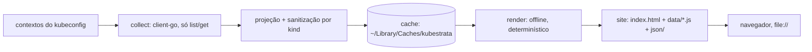

# Design do kubestrata

[English](design.md)

Status: design pré-release da v0.1.0 (F1). As decisões aqui valem até o código dizer o contrário.
A versão em inglês (`design.md`) é a oficial; esta é a tradução.

## Objetivo

Inventário somente leitura dos clusters do kubeconfig, guardado num cache local e exibido numa
visão HTML offline em que **os recursos recentes ficam no centro e os antigos na borda**, mais uma
**comparação lado a lado de dois clusters**. O público é quem planeja uma migração de cluster: o
que existe, quem é o dono, como chegou lá, o que tem estado, o que está exposto e o que ainda está
mudando.

## Fluxo



`render` e `compare` nunca falam com cluster. Atualizar o cache é sempre explícito
(`collect --force`, `--max-age` ou `r` na TUI).

## Eixo do tempo

| Campo | Significado | Uso |
|---|---|---|
| `metadata.creationTimestamp` | criação do objeto; zera quando o CI apaga e reaplica | eixo padrão |
| maior `managedFields[].time`, **ignorando `subresource: status`** | última mudança de spec/metadata por qualquer manager | eixo `alterado`: o que ainda está em movimento |
| idade do Pod | último rollout ou reagendamento, não a idade do workload | não vira eixo: pods são agregados no dono |

Os updates de status são ignorados de propósito: controllers gravam status o tempo todo e tudo
pareceria recente.

## Layout: polar determinístico, não força-dirigido

Ângulo = setor do namespace (agrupado por time, tamanho proporcional ao número de objetos), com
sub-setor por categoria. Raio = idade na escala de anéis escolhida. As arestas (Ingress → Service →
Workload → PVC / Secret / ConfigMap / ServiceAccount) aparecem só no hover ou na seleção.

| Critério | Força-dirigido | Polar (escolhido) |
|---|---|---|
| Escala | repulsão O(n²), serve para centenas | O(n); colisões resolvidas numa grade espacial |
| Comparação | o mesmo objeto cai em lugares diferentes | setores calculados sobre A∪B: mesmo namespace, mesmo ângulo nos dois lados |
| Determinismo | depende da simulação | mesma entrada, mesma imagem |

As escalas de anéis trocam no navegador sem regenerar: `5d`, `10d`, `30d` (12 anéis lineares mais
uma faixa externa comprimida), `log` (7d / 30d / 90d / 1a+, saturando em 3 anos) e custom
`--rings 5,15,30,90,180,365`.

## Coleta

- Kubeconfig: regras padrão do client-go (`KUBECONFIG` com vários arquivos, `--kubeconfig`); exec
  plugins funcionam sem mudança. Falha de auth num contexto vira erro estruturado e não para os
  outros.
- Identidade do cluster: `sha256(URL do servidor + UID do namespace kube-system)[:12]`. Nome de
  contexto não é identidade.
- Discovery (`ServerPreferredResources`): kinds servidos, CRDs e tipos do OpenShift sem lista fixa
  no código. A distro sai dos grupos de API, da URL, da versão e dos labels de node, e os sinais
  usados ficam em `distro_signals` (um OpenShift simulado com CRDs no kind aparece como tal).
- Carga no API server: só `list`/`get`, paginação `limit=500`, QPS/burst explícitos, no máximo 4
  contextos e 8 kinds em paralelo por contexto.
- RBAC: um `403` num kind vai para `errors[]` e a coleta continua. Listar Secrets dá acesso de
  leitura aos valores, mesmo que o kubestrata só peça metadata; a documentação traz um ClusterRole
  `inventory-reader` sugerido.

## Sanitização (fronteira de segurança)

O snapshot guarda uma projeção curada, nunca o objeto bruto.

| Risco | Tratamento |
|---|---|
| Valores de Secret | Secrets são lidos pela Table do servidor (`as=Table;g=meta.k8s.io;v=v1`, `includeObject=Metadata`): tipo e número de chaves, sem `data`. Linha que não vier como `PartialObjectMetadata` é recusada |
| `kubectl.kubernetes.io/last-applied-configuration` | descartada de todo objeto: num Secret aplicado com `kubectl apply` ela guarda o `data` em base64 |
| `env[].value` literal, `args`, `command` | só os nomes; valores descartados |
| ConfigMap | nomes de chave + hash do conteúdo (para drift), sem valores |
| `managedFields` | só `manager`, `operation`, `time`, `subresource` |
| `spec.tls.key` / `certificate` de Route do OpenShift | descartados: fica só o tipo de terminação |
| Annotations de identidade de nuvem (ARN do IRSA, ids de workload identity) | só o tipo (`aws-irsa`, ...), nunca o ARN ou o id |
| Annotations em geral | não são guardadas; os fatos saem das poucas que importam |
| Cache e site | `0700` / `0600` no diretório de cache do usuário, nunca em git |
| XSS na página local | nomes e labels são dado não confiável: `json.Marshal` (escapa `<>&`) grava o `data/*.js` e a página renderiza com `textContent` |

Um teste semeia valores conhecidos em Secrets, env, args, command, annotations, Route e CR, e falha
se qualquer um deles aparecer em qualquer byte do snapshot.

## Kinds e categorias padrão

| Categoria | Kinds | Observação |
|---|---|---|
| workload | Deployment, StatefulSet, DaemonSet, CronJob, Job sem dono, DeploymentConfig, Pod e ReplicaSet **órfãos** | pods agregados no dono; pod órfão é alerta de migração |
| network | Service, Ingress, Route, Gateway, HTTPRoute, NetworkPolicy | hosts e TLS no painel |
| config | ConfigMap (sem `kube-root-ca.crt`, `openshift-service-ca.crt`), Secret, ServiceAccount (sem o `default`, salvo com identidade de nuvem ou pull secret) | Secrets `helm.sh/release.v1` agrupados como estado do Helm |
| storage | PVC, PV, StorageClass, VolumeSnapshot | kinds de escopo de cluster ganham setor próprio |
| policy | HPA, PDB, ResourceQuota, LimitRange, Role, RoleBinding | PDB afeta drain e cutover |
| CRDs | recursos customizados | agrupados por API group |
| sistema | namespaces que casam com `^(kube-|openshift|amazon-|aws-|gke-|azure-|local-path-storage$)` | escondidos por padrão (`--system-ns`) |

## Contrato do snapshot (`schema_version: 1`)

```json
{
  "schema_version": 1,
  "tool": {"name": "kubestrata", "version": "0.1.0"},
  "collected_at": "2026-11-17T12:12:00Z",
  "cluster": {"id": "3f9a1c0b7e21", "context": "source", "server_host": "api.example:6443",
              "distro": "openshift", "distro_signals": ["group route.openshift.io"], "version": "v1.27.x",
              "nodes": {"count": 12, "arch": {"amd64": 12}, "zones": ["a", "b"]}},
  "namespaces": [{"name": "payments", "team": "team-payments", "created": "2024-06-01T00:00:00Z"}],
  "resources": [{
    "id": "apps/Deployment/payments/api", "cat": "workload", "ns": "payments", "name": "api",
    "created": "2025-04-24T10:00:00Z", "changed": "2026-10-02T18:30:00Z",
    "manager": "helm", "app": "payments-api", "team": "team-payments",
    "facts": {"replicas": 3, "ready": 3, "pods": 3, "restarts": 1, "images": ["registry/pay/api:2.14"]},
    "fp": "sha256:..."
  }],
  "edges": [{"from": "networking.k8s.io/Ingress/payments/api", "to": "core/Service/payments/api", "rel": "routes"}],
  "errors": [{"kind": "core/Secret", "ns": "data", "reason": "Forbidden"}]
}
```

| `rel` | De → para |
|---|---|
| `routes` | Ingress, Route, HTTPRoute → Service |
| `selects` | Service, PodDisruptionBudget → workload (selector ⊆ labels do pod template) |
| `mounts` | workload → PVC, Secret, ConfigMap (volumes); VolumeSnapshot → PVC |
| `env-from` | workload → Secret, ConfigMap (`envFrom`, `valueFrom`) |
| `uses-sa` | workload → ServiceAccount |
| `pull-secret` | workload → Secret (`imagePullSecrets`) |
| `owns` | dono controlador → objeto exibido (ex.: recurso customizado → seu Deployment) |
| `binds` | PVC → PersistentVolume, StorageClass |
| `tls` | Ingress, Gateway → Secret |
| `scales` | HPA → alvo |
| `grants` | RoleBinding → Role, ServiceAccount |
| `attaches` | HTTPRoute → Gateway |

As arestas são calculadas em Go, não no navegador. Referência a objeto que não existe vai para
`facts.missing_refs`; Service cujo selector não casa com nenhum workload ganha
`facts.selects_none`. Consumidor que recebe `schema_version` maior que o suportado recusa o
documento.

Pods, ReplicaSets, ReplicationControllers e Jobs são agregados no dono exibido mais próximo
(`pods`, `ready`, `restarts`, `pod_newest`, `pod_oldest`, `archs`, `last_rollout`, `jobs`,
`last_run`). Sem dono, aparecem com `facts.orphan`.

## Comparação

Chave de identidade: `group/kind/namespace/name`. Estados: só na origem (pendente), só no destino
(novo), igual, drift. O drift usa um fingerprint por kind dos campos relevantes para migração; um
hash do spec inteiro acusaria diferenças de default entre versões do Kubernetes.

| Kind | Fingerprint |
|---|---|
| Deployment, StatefulSet, DaemonSet, DeploymentConfig | imagens (repo:tag@digest), réplicas, requests/limits, nomes de volumes e de envFrom |
| Service | type, ports |
| Ingress, Route, HTTPRoute | hosts, paths, nomes dos Secrets de TLS, class |
| PVC | storageClass, tamanho, accessModes |
| ConfigMap | nomes de chave + hash do conteúdo |
| Secret | tipo + número de chaves |

Zoom e pan sincronizados; o hover num nó destaca o par dele. Uma tabela por namespace mostra total
na origem, total no destino, pendentes, drift, só no destino e cobertura.

## CLI e TUI

Fang v2 sobre Cobra nos comandos; Bubble Tea v2, Bubbles v2, Lip Gloss v2 e Huh na TUI.
`--format text|json` em todo comando.

| Comando | Faz |
|---|---|
| `kubestrata` | TUI: contextos, idade do cache, status; `r` refresh, `g` gerar, `c` comparar, `o` abrir |
| `kubestrata contexts` | contextos do kubeconfig (sem acessar cluster) |
| `kubestrata collect [-c ctx]... [--all] [--max-age 6h] [--force]` | grava no cache; reaproveita snapshot mais novo que `--max-age` |
| `kubestrata render [-c ctx] [--scale 5d\|10d\|30d\|log] [--axis created\|changed] [-o dir] [--open]` | site a partir do cache |
| `kubestrata compare -c source -c target [--open]` | site lado a lado a partir do cache |
| `kubestrata cache ls\|prune [--keep 5]` | manutenção dos snapshots |

Saída do site (padrão no diretório de cache do usuário): `index.html` (CSS e JS inline, sem CDN),
`data/<cluster_id>.js` (`window.SNAP["<id>"] = {...}`; tag script, porque o Chrome bloqueia
`fetch()` de JSON local em `file://`), `json/<cluster_id>.json` para máquina.

## Fases

| Fase | Escopo | Pronto quando |
|---|---|---|
| F1 (v0.1.0) | contexts, collect + cache, render, compare, TUI básica, saída JSON | e2e verde em dois clusters locais; HTML golden idêntico entre execuções; teste de não vazamento verde; página sem erro de JS no Chrome headless; 20k nós com pan e zoom medidos |
| F2 | unidades de migração, classificação (manager, estado, exposição, acoplamento à nuvem, fim de vida), `plan --format json\|csv\|md`, resumo por time, `--map-ns` | plano do fixture bate com uma verdade-base fixa |
| F3 | diff temporal entre snapshots, checagem de imagem multi-arch, `kubectl strata` via Krew | decidido quando a F2 estiver em uso real |
